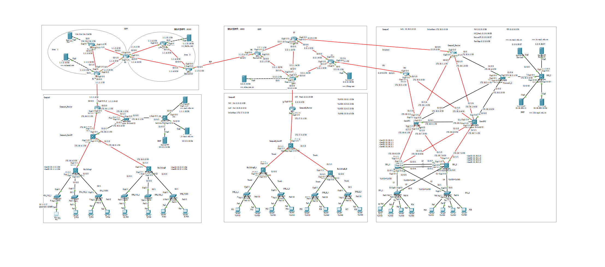

# 🏢 校园网络多区域 OSPF 与 VRRP 高可用网络架构设计

本项目基于 Cisco Packet Tracer 搭建，模拟了一个中大型网的核心网络架构。包含完整的路由协议配置、冗余网关设计及安全策略。

## 📌 1. 网络拓扑全景图

 

---

## ⚙️ 2. 应用核心技术

- **动态路由协议**：多区域 OSPF（Area 0 骨干区域 + 业务区域），实现全网路由收敛与路径优化。
- **网关冗余**：VRRP（虚拟路由冗余协议），结合接口 Track 实现双核心交换机的主备自动切换。
- **局域网规划**：VLAN 划分 + Trunk 链路 + 多层交换机 SVI 路由。
- **边界安全与 NAT**：ACL 访问控制列表限制敏感网段 + NPT/PAT 地址转换。

---

## 🔍 3. 核心功能与排错验证

### OSPF 邻居状态与 DR/BDR 检查
- 通过 `show ip ospf neighbor` 验证各区域邻居均达到 `FULL` 状态。
- 确认广播网段内成功选举 DR/BDR，避免 LSA 泛洪风暴。

### VRRP 主备切换测试
- 手动 Shutdown 主网关上联接口，流量在 3 秒内平滑无感切至 Backup 网关。

## 📁 4. 文件说明

- `网络搭建模拟案例 - yf - 15178906294.pkt`：Cisco Packet Tracer 拓扑源文件（建议使用 v8.0+ 版本打开）。
